# Kod Akışı

**Watch Claude write your code, live, in a pane beside the chat.** A mod for [Claude Code](https://claude.com/claude-code); the name is Turkish for “code stream”. · [Türkçe](README.tr.md)



<sub>The preview is an illustration; the pane is drawn with Claude Code's own font and color theme.</sub>

While Claude writes a file you usually see a spinner and collapsed rows. Kod Akışı streams the code into a pane beside the conversation as the model produces it: files with line numbers and syntax colors, edits as a live diff, commands with the tail of their output. When thinking text is being sent, it streams in a box of its own; when subagents are at work, each one gets its own row.

It asks the model for nothing extra. It draws the response stream that is already arriving, so it costs no additional tokens.

## Install

In a Claude Code terminal session, type at the prompt:

```
/plugin install kod-akisi --marketplace Ilyas-jpg/kod-akisi
```

Answer `y` to add the marketplace, then pick a scope. From a shell, the same thing is:

```bash
claude plugin install kod-akisi --marketplace Ilyas-jpg/kod-akisi
```

In the desktop app, where `/plugin` does not run: click **+** next to the prompt box, then **Plugins**, **Add marketplace** with `Ilyas-jpg/kod-akisi`, then **Add plugin**.

Then open a new session. Mods need Claude Code 2.1.287 or later in the terminal, 2.1.286 or later in the desktop app. Kod Akışı was last checked on 2.1.325.

## Use

The pane opens by itself when a session starts. As soon as Claude writes a file, edits one or runs a command, the code streams in the pane.

| Command | What it does |
|---|---|
| `/kod-akisi` | Opens the pane. |
| `/kod-akisi off` | Closes the pane and stops it from opening by itself. `/kod-akisi` brings it back. |
| `/kod-akisi tr` | Switches the pane to Turkish. |
| `/kod-akisi en` | Switches it back to English. |

In a terminal the pane opens by itself in a wide window; in a narrow one, type `/kod-akisi`.

## Language

The pane is in English by default and also speaks Turkish. The choice is remembered across sessions, and numbers follow it: `3.4 s` in English, `3,4 sn` in Turkish.

## What is in the pane

- **Stage.** The file being written streams with line numbers and syntax colors, following the last lines with a cursor at the tip. Edits arrive as a live diff and become the real numbered patch once the tool finishes. Commands show the tail of their output underneath.
- **Header.** What Claude is doing right now, how many subagents are running, tool count, output tokens and elapsed time. Under it, a graph of the stream rate: bars are born on the right and fade as they walk left.
- **Thinking.** The model's thinking text streams in a violet box that follows its last lines. While a tool runs, the last thought stays readable, dimmed.
- **Agents.** One row per running subagent: its type, what it is doing, tool count and time.
- **Ticker.** The live tip of the narration text.
- **Log.** Recent tool calls, newest first. A subagent's calls are marked with that agent's color.

It is not only `Write` and `Edit`: any long or multi-line tool argument, such as a SQL query, HTML or a long prompt, takes the stage.

## Seeing the thinking

Claude Code sends thinking text only when asked to. Otherwise the model still thinks, but the text is not in the stream and the pane has nothing to draw.

- **Desktop app:** in the conversation's title menu choose Transcript view › Thinking (or Verbose). The default view for new sessions is in Settings.
- **Terminal:** add `"showThinkingSummaries": true` to `~/.claude/settings.json`.

What arrives is the thinking summary Claude Code provides, not the model's raw inner monologue. When thinking is happening unseen, the pane shows a dim note on how to turn it on for the first few turns, then stays quiet.

## Subagents

When Claude hands work to subagents, each one gets a row in the pane. The stage shows whichever loop is writing code at the moment and puts the agent's name in its header. The main conversation always has priority; parallel agents do not cut into each other's stream, the stage moves on once a stream settles.

An agent running in the background stays visible after the main conversation finishes, and the header says how many are still working. In the terminal, opening an agent's transcript from the task list makes the pane draw that agent alone.

The engine's own internal loops (compaction, memory and the like) are not agents and never show up in the pane.

## Updating and removing

```bash
claude plugin marketplace update ilyassaltay
claude plugin update kod-akisi@ilyassaltay
```

Then start a new session. To remove it: `claude plugin uninstall kod-akisi@ilyassaltay`.

If you installed an earlier version with `git clone` into `~/.claude/skills/kod-akisi`, update it with `git -C ~/.claude/skills/kod-akisi pull`, or delete that folder and install as above.

## What it can and cannot do

A mod is code that runs with your permissions, so it is fair to ask what this one touches.

Kod Akışı listens to the model's response stream on `turn.step`, decodes tool arguments from their partial JSON and draws the pane. It never changes the stream or a tool result; every chunk passes through as it came, and a failure in the pane's own code cannot stop a tool call.

It makes no network, file system or process calls. Everything it asks of the engine: opening and closing its pane, keeping its own state and three small preferences (open by itself, language, how often the thinking hint was shown), timers, registering its command, a toast, reading the list of subagents and one line in the debug log. You do not have to take that on trust:

```bash
claude plugin validate .claude-plugin/plugin.json
```

prints every hook and every engine call, read off the source.

## Limits

- The mods API can change with a Claude Code update. If it does, the pane does not appear; the session itself is unaffected.
- Used in the Windows desktop app and exercised on the terminal surface through Claude Code's test kit. Nothing in the code is specific to an operating system, so it is expected to work on macOS and Linux; it has not been tried there yet, nor in the VS Code extension.

## Develop

```bash
claude plugin validate .claude-plugin/plugin.json
claude plugin test .
```

The first reads the hooks and engine calls the way Claude Code does. The second replays a scripted model stream and draws the pane on the desktop and terminal surfaces, in both languages; `tests/yerlesim.test.ts` also prints a plain-text preview of the pane.

The terminal is a grid of cells, while the desktop app draws text in a proportional font. So rows are both fitted to columns and laid out with flexible boxes, and the speed graph is drawn with block characters in the terminal and as a vector that stretches to the row's width everywhere else.

The source is four files: `hooks/register.tsx` (hooks and drawing), `hooks/akis.ts` (streaming JSON reader, tail buffer, diffs), `hooks/dil.ts` (interface language) and `types/index.d.ts` (the pane's state contract). File names and comments are in Turkish. What changed in each version is in [CHANGELOG.md](CHANGELOG.md).

## License

[MIT](LICENSE). Made by İlyas Saltay · [ilyassaltay.com](https://ilyassaltay.com)

Built together with Claude Code; validation and tests are in the repository.
